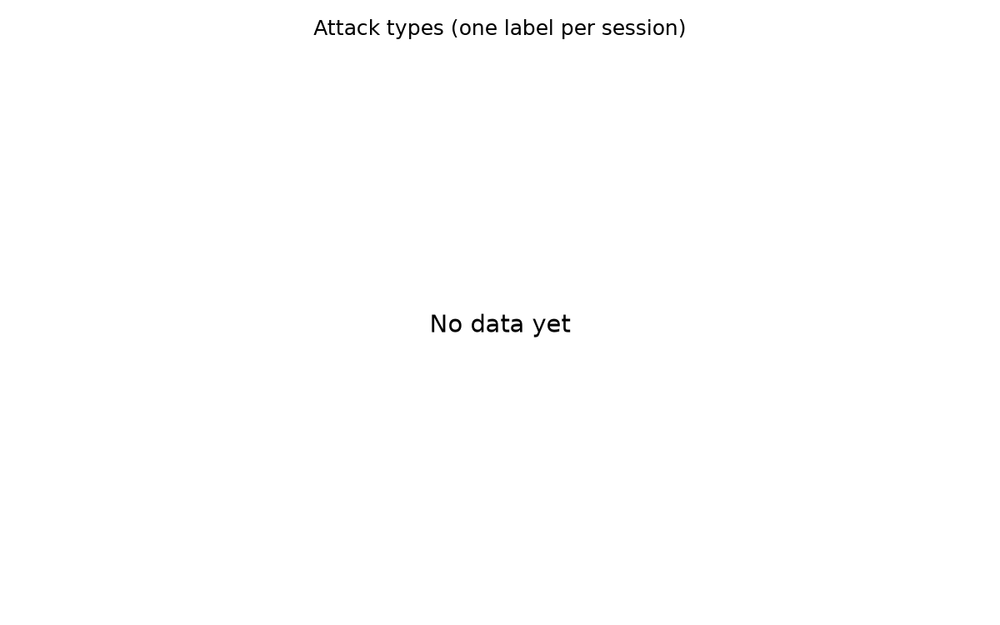

# SSH Honeypot on AWS — Attack Analysis

A real SSH honeypot running on AWS and open to the internet, plus Python code that analyzes what attackers do once they think they're in: the passwords they try, the commands they run, the malware they fetch, and where they come from.

> **Status:** honeypot live since 24 Nov 2026 · collecting data · the findings below will be filled in once enough data is in.

---

## Key findings

_Collected over [N] days ([start date] – [end date])._

| Metric | Value |
| --- | --- |
| Connections | [X] |
| Unique attacker IPs | [X] |
| Countries | [X] |
| Successful fake logins | [X] |
| Sessions that ran commands | [X] |
| Sessions that tried to download a file | [X] ([X]%) |

- **Most-tried password:** `[X]` ([X]% of all login attempts)
- **Most-targeted usernames:** `[X]`, `[X]`, `[X]`
- **Busiest hour (UTC):** [X]
- **Top country:** [X] ([X]% of connections)
- **Most common attack type:** [X] ([X]% of sessions that ran commands)

## Charts

| | |
| --- | --- |
|  |  |
|  |  |

---

## Architecture

```text
 Internet bots
      │  SSH, port 22
      ▼
┌──────────────────────────── AWS EC2 (Ubuntu 24.04) ────────────────────────────┐
│                                                                                │
│  iptables: port 22 ──► 2222        Cowrie honeypot (fake shell, fake files)    │
│                                          │                                     │
│  real admin SSH: port 22222              ▼                                     │
│  (my IP only)                     cowrie.json (one JSON event per line)        │
└──────────────────────────────────────────┬─────────────────────────────────────┘
                                           │  download logs
                                           ▼
                         Python analysis (pandas, matplotlib)
                   load ─► add country ─► classify ─► stats & charts
```

**How it works**

1. **The trap.** [Cowrie](https://github.com/cowrie/cowrie), a medium-interaction SSH honeypot, runs on an EC2 instance. iptables redirects port 22 to Cowrie, so bots scanning the internet for SSH land in a fake Linux shell. Nothing they type actually runs.
2. **Isolation.** The real admin SSH runs on a separate port that the AWS security group opens only to my IP. The honeypot machine holds no real data or credentials.
3. **Logging.** Cowrie records every connection, login attempt, command and file download as JSON.
4. **Analysis.** The Python code loads the logs, looks up each attacker's country, labels each session by attack type, and produces the numbers and charts above.

## Attack classification

`analysis/classify.py` gives each session that ran commands one label. The rules are checked in this order and the first match wins, so a session that downloads a miner with `curl` counts as a crypto-miner:

| Label | Matched when the commands contain |
| --- | --- |
| Crypto-miner | `xmrig`, `miner` |
| Persistence (backdoor key) | `authorized_keys` |
| Malware download | `wget`, `curl`, `tftp` |
| Reconnaissance | `uname`, `/proc/cpuinfo`, `free -m`, `whoami`, `/etc/passwd` |
| Other | none of the above (e.g. only `ls` or `exit`) |

Download attempts are also counted separately from the label, so the download share includes miner sessions.

---

## Project structure

```text
honeypot-analysis/
├── analysis/
│   ├── load.py        # load Cowrie JSON logs into a DataFrame
│   ├── geo.py         # IP → country lookup
│   ├── stats.py       # summary statistics
│   ├── classify.py    # label sessions by attack type
│   └── plots.py       # charts saved to figures/
├── data/sample/       # small anonymized sample (IPs masked)
├── figures/           # generated charts
├── setup/install.sh   # installs Cowrie, moves SSH to 22222, redirects port 22
└── requirements.txt
```

## Run it yourself

Requires Python 3.11+.

```bash
git clone https://github.com/thanna23/honeypot-analysis.git
cd honeypot-analysis
python3 -m venv .venv && source .venv/bin/activate
pip install -r requirements.txt
```

Download the free [DB-IP Country Lite](https://db-ip.com/db/download/ip-to-country-lite) database and unzip it into the project root as `dbip-country-lite.mmdb`. Put your Cowrie logs (`cowrie.json*`) in `data/raw/`, then run from the project root:

```bash
python analysis/stats.py      # connections, usernames, passwords, commands, countries
python analysis/classify.py   # attack types and download share
python analysis/plots.py      # writes the 4 charts to figures/
```

Raw logs are not published. An anonymized sample is in `data/sample/`.

## Privacy and safety

- Only aggregated statistics and a small sample with **masked IP addresses** (e.g. `185.220.x.x`) are published.
- No credentials, keys or server addresses are stored in this repository.
- The honeypot only emulates a shell: attackers can't run real commands or use it to attack other machines.

## What I'd improve next

- Automate log shipping with S3 + Lambda + DynamoDB for a live dashboard
- Define the whole infrastructure in Terraform so it deploys with one command
- Add unit tests for the classification rules
- Group attackers by SSH client fingerprint (HASSH) to identify botnets and tools
- Run honeypots in several AWS regions and compare attack patterns

## Tech stack

AWS EC2 · Ubuntu · Cowrie · iptables · Python · pandas · matplotlib · geoip2

## Credits

- [Cowrie](https://github.com/cowrie/cowrie) SSH honeypot
- IP geolocation by [DB-IP](https://db-ip.com), licensed under CC BY 4.0
